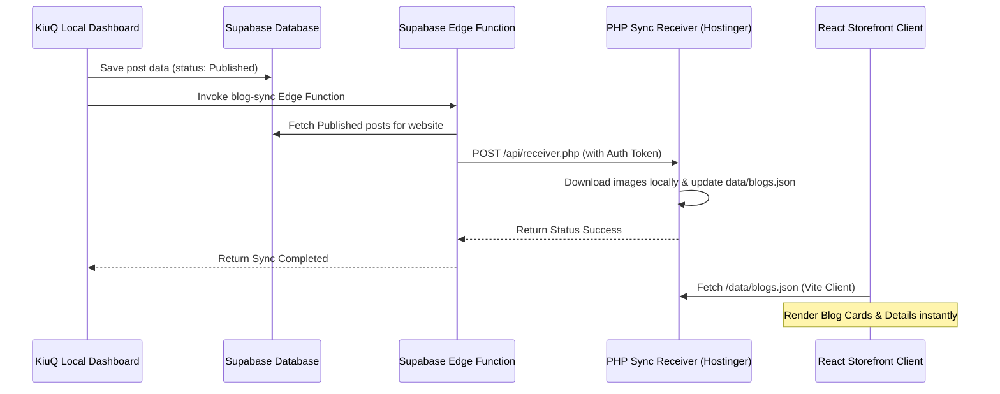

<div align="center">

# ⚡ KiuQ Workflow System
### Centralized Content Publishing Dashboard & Cross-Storefront Sync Engine

<p align="center">
  <sub>Developed by <strong>Seng Chhunsour</strong></sub>
</p>

[](https://github.com/Chhunsour)
[](https://vuejs.org/)
[](https://tauri.app/)
[](https://www.typescriptlang.org/)
[](https://vitejs.dev/)
[](https://tailwindcss.com/)
[](https://supabase.com/)
[](LICENSE)

</div>

---

The **KiuQ Workflow System** is an enterprise publishing dashboard, WordPress prompt pipeline, and headless content distribution engine. It enables content teams to create, edit, organize, and push content directly to connected storefronts and applications with zero cross-database lock-in.

---

## 🚀 Quick Start (Local Development)

### 1. Central Admin Dashboard (KiuQ Web & Desktop)
* **Directory**: `/web`
* **Technology**: Vue 3 + Tauri 2 (Vite + TypeScript + Tailwind CSS + Pinia + Tiptap)
* **Start Server**:
  ```bash
  cd web
  npm install
  npm run dev
  ```
* **Local URL**: [http://localhost:5175](http://localhost:5175)

### 2. WhatsApp Notification Microservice
* **Directory**: `/notification-service`
* **Technology**: Node.js + TypeScript (`whatsapp-web.js` + Supabase)
* **Start Service**:
  ```bash
  cd notification-service
  npm install
  npm run dev
  ```

---

## 🛠️ Architecture & Integration Flow

The KiuQ Blog & Content system is decoupled from third-party storefront databases. It uses an ultra-fast **push-to-JSON** architecture to optimize performance, caching, and eliminate storefront database dependencies.



### 1. Database Layer (`public.blog_posts`)
* Manages the canonical state of all blog articles and publication workflows.
* Row-Level Security (RLS) is active:
  - Anon reads are permitted only for `status = 'Published'`.
  - Authenticated inserts and updates are tied to user profiles.
  - Realtime publication is enabled to stream updates.
* **Migration**: Located in `supabase/migrations/20260630091000_create_new_blog_posts.sql`.

### 2. Supabase Storage Bucket (`blog-images`)
* Public bucket used to store editor-uploaded assets.
* Direct upload capabilities from the Vue editor panel.

### 3. Central Sync Handler (`blog-sync` Edge Function)
* **Code Location**: `supabase/functions/blog-sync/index.ts`
* Triggered from the publish flow in KiuQ. It validates caller privileges, queries all published posts for target websites, and pushes the payload in batches to the website's receiver endpoint.

### 4. Framework PHP Receiver (`receiver.php`)
* **Code Location**: `receiver/receiver.php`
* Accepts sync payloads from the Edge Function using secure handshake tokens.
* Downloads external image assets to the local server storage and maintains the JSON index `/data/blogs.json`.

### 5. Frontend Client Rendering (`blogStore.ts`)
* Fetches the local JSON file (`/data/blogs.json`) and parses it to render the blog cards and post detail views directly.
* Decoupled from storefront product databases, ensuring zero cross-environment database dependencies.

---

## 📦 Deployment Configuration

### 💻 Hostinger Deployments
* **Git Auto-Deployment**: Configured via GitHub App integration. Pushes to the `main` branch trigger automated redeployments.
* **Environment Configuration**: Key variables are managed inside Hostinger's Node.js application settings dashboard.
* **Important Override Rule**: Since Hostinger environment variables override `.env` files, `blogStore.ts` explicitly defaults the blog source type (`useLocalBlogs = true`) to avoid Hostinger's `VITE_PRODUCTS_SOURCE` settings overriding the blog system back to Supabase querying.

---

## 👤 Author & Developer

**Developed by Seng Chhunsour**
- **GitHub:** [@Chhunsour](https://github.com/Chhunsour)
- **Repository:** [https://github.com/Chhunsour/KiuQ-Workflow-System](https://github.com/Chhunsour/KiuQ-Workflow-System)

---

## 📄 License

This project is open-source under the MIT License.
