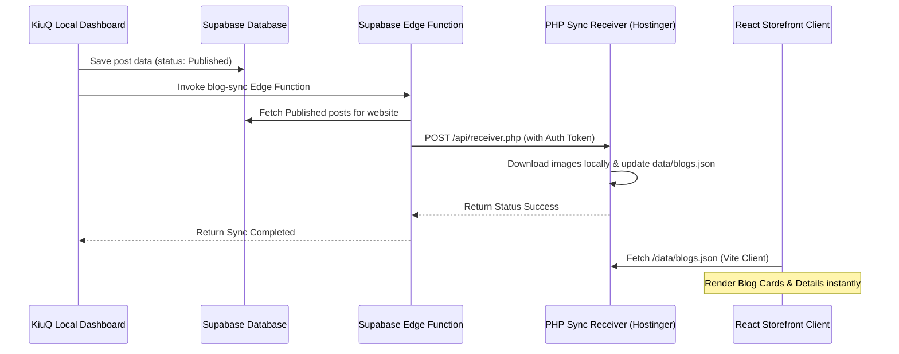

# KiuQ Workflow System & Konstructz Blog Integration

This repository hosts the **KiuQ Workflow System** (WordPress Prompt System), a centralized management dashboard used to create, organize, and push content to connected storefronts.

---

## 🚀 Quick Start (Local Development)

### 1. Central Admin Dashboard (KiuQ System)
* **Directory**: `/web`
* **Technology**: Vue 3 (Vite + TypeScript + Tailwind)
* **Start Server**:
  ```bash
  cd web
  npm install
  npm run dev
  ```
* **Local URL**: [http://localhost:5175](http://localhost:5175)

### 2. Connected Website (Konstructz Storefront)
* **Directory**: `/Users/sour/Documents/Konstructz Project Website`
* **Technology**: React (Vite + TypeScript + Tailwind)
* **Start Server**:
  ```bash
  cd "/Users/sour/Documents/Konstructz Project Website"
  npm install
  npm run dev
  ```
* **Local URL**: [http://localhost:5173](http://localhost:5173)

---

## 🛠️ Architecture & Integration Flow

The Konstructz Blog system is decoupled from third-party databases. It uses a **push-to-JSON** architecture to optimize performance, caching, and avoid direct database dependencies.



### 1. Database Layer (`public.blog_posts`)
* Manages the canonical state of all blog articles.
* Row-Level Security (RLS) is active:
  - Anon reads are permitted only for `status = 'Published'`.
  - Authenticated inserts and updates are tied to user profiles.
  - Realtime publication is enabled to stream updates.
* **Migration**: Located in `supabase/migrations/20260630091000_create_new_blog_posts.sql`.

### 2. Supabase Storage Bucket (`blog-images`)
* Public bucket used to store editor-uploaded assets.
* Direct upload capabilities from the Vue editor panel.

### 3. Central Sync Handler (`blog-sync` Edge Function)
* **Code Location**: `supabase/functions/blog-sync/index.ts`
* Triggered from the publish flow in KiuQ. It validates caller privileges, queries all published posts for target websites, and pushes the payload in batches to the website's receiver endpoint.

### 4. Framework PHP Receiver (`receiver.php`)
* **Code Location**: `receiver/receiver.php` (on Konstructz server)
* Accepts sync payloads from the Edge Function using secure handshake tokens.
* Downloads external image assets to the local server storage and maintains the JSON index `/data/blogs.json`.

### 5. Frontend Client Rendering (`blogStore.ts`)
* **Code Location**: `src/lib/blogStore.ts` (in Konstructz Project Website)
* Fetches the local JSON file (`/data/blogs.json`) and parses it to render the blog cards and post detail views directly.
* Decoupled from storefront product databases, ensuring zero cross-environment database dependencies.

---

## 📦 Deployment Configuration

### 💻 Hostinger Deployments
* **Git Auto-Deployment**: Configured via GitHub App integration. Pushes to the `main` branch trigger automated redeployments.
* **Environment Configuration**: Key variables are managed inside Hostinger's Node.js application settings dashboard.
* **Important Override Rule**: Since Hostinger environment variables override `.env` files, `blogStore.ts` explicitly defaults the blog source type (`useLocalBlogs = true`) to avoid Hostinger's `VITE_PRODUCTS_SOURCE` settings overriding the blog system back to Supabase querying.
